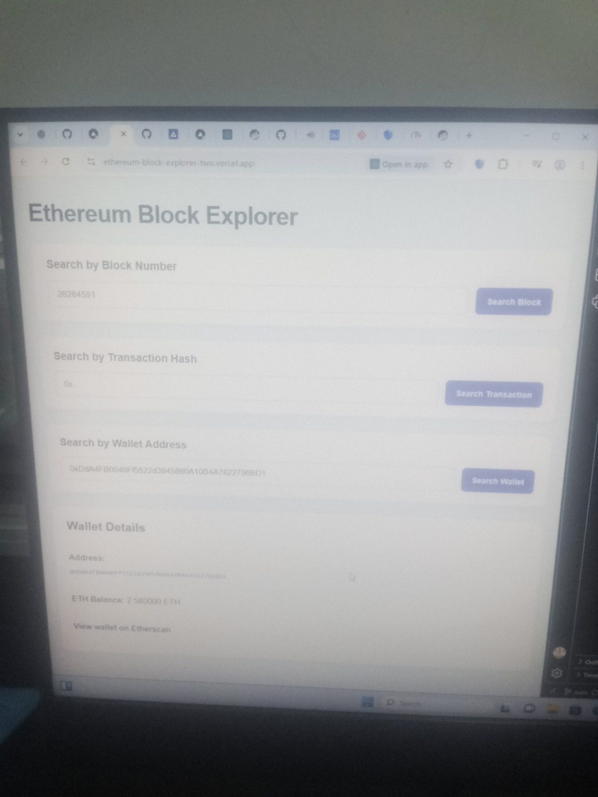

# Ethereum Block Explorer

A web-based Ethereum blockchain explorer built with React.js and the Alchemy SDK. Search blocks, inspect transaction details, and check Ethereum wallet balances through a responsive interface.

## Project Preview



**Live Demo:** [View Ethereum Block Explorer](https://ethereum-block-explorer-two.vercel.app/)

**Source Code:** [GitHub Repository](https://github.com/samuelalikali02-glitch/ethereum-block-explorer)

## Features

- **Latest Block:** Retrieve the latest Ethereum Mainnet block number.
- **Block Search:** Search for a block using its block number.
- **Transaction Lookup:** Inspect transaction details, including sender, recipient, ETH value, gas information, and transaction status.
- **Wallet Lookup:** Check an Ethereum address's ETH balance.
- **Etherscan Integration:** Open relevant blockchain information in Etherscan.
- **Responsive Interface:** Use the application on desktop and mobile devices.

## Built With

- React.js
- JavaScript
- Alchemy SDK
- Ethereum Mainnet
- CSS
- Git and GitHub
- Vercel

## Getting Started

### Prerequisites

Install [Node.js](https://nodejs.org/) and Git before starting.

### Installation

1. Clone the repository:

   ```bash
   git clone https://github.com/samuelalikali02-glitch/ethereum-block-explorer.git
   ```

2. Navigate to the project directory:

   ```bash
   cd ethereum-block-explorer
   ```

3. Install the dependencies:

   ```bash
   npm install
   ```

### Configure the Alchemy API

1. Create an Ethereum Mainnet app through the [Alchemy Dashboard](https://dashboard.alchemy.com/).
2. Create a `.env` file in the project root, alongside `package.json`.
3. Add your API key:

   ```env
   REACT_APP_ALCHEMY_API_KEY=your_alchemy_api_key
   ```

   Replace `your_alchemy_api_key` with your own key. Never commit your actual API key to GitHub.

### Run Locally

Start the development server:

```bash
npm start
```

Open [http://localhost:3000](http://localhost:3000) in your browser.

## Deployment

The application is deployed on Vercel.

To deploy your own version, connect your GitHub repository to [Vercel](https://vercel.com/) and configure the required environment variable in the project settings.

**Security note:** Create React App exposes `REACT_APP_` environment variables in the browser bundle. Restrict your Alchemy key where possible and consider a backend proxy for stronger protection.

## What I Learned

Through this project, I gained practical experience with:

- Connecting a React application to Ethereum Mainnet.
- Retrieving blockchain data through an API.
- Searching for blocks and inspecting transactions.
- Reading wallet balances and displaying blockchain data.
- Managing project code with Git and GitHub.
- Deploying a web application using Vercel.
- Configuring environment variables and troubleshooting API connectivity.

## Future Improvements

- Display full block details and transaction lists.
- Add wallet transaction history.
- Improve loading indicators and error handling.
- Add support for additional Ethereum networks.
- Introduce a backend API layer to improve API key protection.

## Author

**Samuel Alikali-Ojima Ojo**

Final-year Mechatronics Engineering student exploring Web3, embedded systems, robotics, and AI/ML.

- **Live Project:** https://ethereum-block-explorer-two.vercel.app/
- **GitHub:** https://github.com/samuelalikali02-glitch

